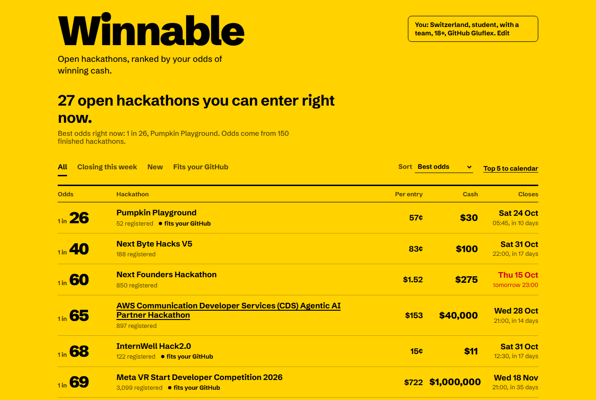
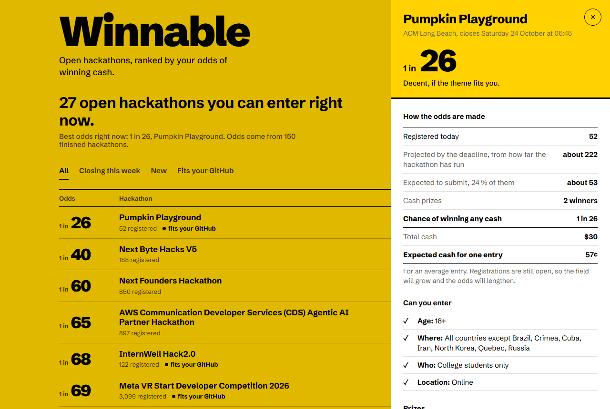
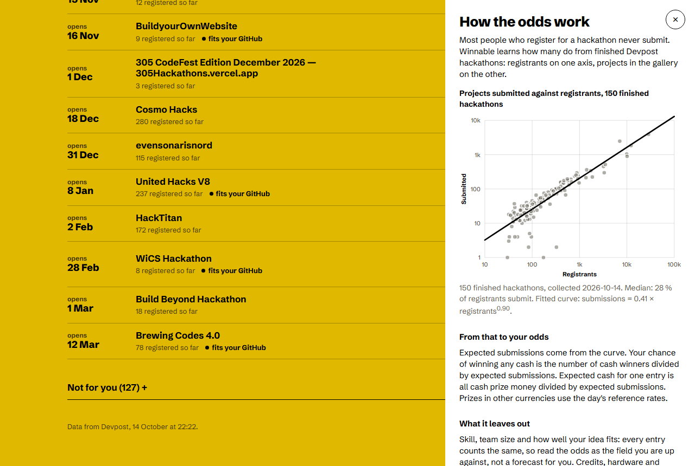

# Winnable

**Open hackathons, ranked by your odds of winning cash.**

Devpost lists every hackathon by prize or deadline. The biggest prize is rarely the best bet: on 14 October 2026 Amazon's hackathon, USD 128,000 in cash and 55,000 registrants, worked out at about 1 in 900 for an average entry. An AWS hackathon open to the same people, USD 40,000 and 900 registrants, was 1 in 65. Winnable reads every open Devpost hackathon each day, works out how many people will really submit, counts only cash, checks whether you may enter at all, and ranks what is left by your odds.



## What it does

- **Odds per hackathon.** "1 in 65" means one cash prize for every 65 expected submissions.
- **Calibrated, not guessed.** Most registrants never submit. Winnable learns how many do from finished Devpost hackathons: registrants against the projects in their galleries. The first calibration used 150 finished hackathons; the median submission rate was 28 %, and the fitted curve is submissions = 0.41 × registrants^0.90. The chart is in the app under "How the odds work".
- **Cash only.** Credits, gift cards, licences, scholarships, swag and participation awards are listed but never counted. Devpost's "in cash" label is checked against the prize's own words: "$5,000 in Deployxa credits + 12 months of Pro" or "$2,000 in Momen credits" count as nothing, with the reason shown. Amounts written only into the prize text are read with their multipliers ("$100 each to 20 people").
- **Can you enter.** Country, age, student status (university or high school) and team are checked against each hackathon's eligibility list, with the reason shown when you cannot: "Not open in Brazil", "High school students only", "In person: Bengaluru", "Team of 2 or more required". Member-only events stay blocked with their own wording.
- **Fields still growing.** Registrations keep coming until the deadline, so the field is projected from how much of the submission period has passed. Hackathons that have not opened yet, or have run less than a fifth of their period, are listed under "Opening soon or just opened", without odds: four registrants on day one would otherwise read as 1 in 1. Deadlines under 24 hours away drop to the end of the list.
- **Fits your GitHub.** Optional: your public repos' languages, topics and descriptions are matched to hackathon themes.
- **Calendar.** One click puts a deadline, or your top five, into your calendar with a reminder two days before.
- **Private by design.** Your profile stays in your browser. The only outside request is the optional GitHub lookup.

| Detail and the arithmetic behind each number | How the odds work |
|---|---|
|  |  |

## How it works

```
collector/collect.py   daily: Devpost API + every hackathon page -> data/hackathons.json
                       weekly: finished hackathons -> calibration (submissions = a * registrants^b)
site/                  static board: ranks, checks and renders everything in the browser
.github/workflows/     runs the collector every morning and commits fresh data
tests/                 node tests for the odds, eligibility, calendar and GitHub matching;
                       a Playwright click-through for desktop, dark mode and phone
```

For each open hackathon:

- projected registrants = registrants today / share of the submission period elapsed (at least 15 %)
- expected submissions = a × projected registrants^b
- chance of winning any cash = cash prize winners / expected submissions
- expected cash for one entry = total cash prize money / expected submissions

Every entry counts the same: skill, team and fit are not modelled, so the odds describe the field you are up against, not a forecast for you.

## Run it locally

```
python collector/collect.py          # first run about 20 minutes (calibration), later runs about 3
python -m http.server 8080           # then open http://localhost:8080/site/
node tests/test_rank.mjs && node tests/test_ics_github.mjs
```

Needs Python 3.12 and curl (Devpost refuses Python's own HTTP client). No dependencies, no build step.

## Built with AI

Planned and built with an AI coding agent using the Devpost Learn skill pack. The scope, product requirements, technical spec and build checklist, including every place where the build proved the plan wrong, are in [`devpost/`](devpost/).

## Data

Hackathon names, dates, themes, eligibility lists and prize lines come from Devpost's public pages; Winnable links back to each hackathon and copies no descriptions. Currency rates: European Central Bank via frankfurter.app.

## License

MIT
